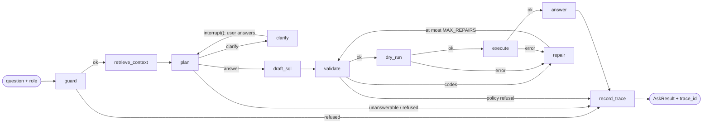

# governor

A small, code-first data platform: one foundation (`core`: a billing warehouse, catalog, lineage, owners, PII policy, LLM client, traces) and modules that put agents on top of it. The first module is **governor-ask**, governed natural-language questions over the warehouse.

## Problem

A small data team gets the same questions over and over ("what was MRR last month?", "who are our biggest customers in Peru?"). A plain text-to-SQL bot answers them fast, but it picks the wrong grain, answers ambiguous questions with a guess, and will happily select a customer's email for anyone who asks. governor-ask answers in plain language while Python, not the model, owns the facts:

- the role comes from the caller's token, and the access policy (`knowledge/access.yaml`, `knowledge/policy.yaml`) is data, owned by a human;
- every SQL draft goes through a default-deny validator before it touches DuckDB, and the warehouse is opened read-only;
- ambiguous questions get a clarifying question, out-of-scope ones get "unanswerable", and policy violations get a refusal that names the rule;
- every answer leaves a redacted decision trace.

## How to run

Python 3.12 and [uv](https://docs.astral.sh/uv/). Real models go through OpenRouter with `OPENROUTER_API_KEY` from the environment; everything also runs offline with a fake LLM.

```bash
uv sync
uv run python fixture/build_green.py                       # build the warehouse (dbt + DuckDB, seed 42, pinned as_of)
uv run python -m governor.core.harvest artifacts/green --out artifacts/meta.duckdb
uv run python -m governor.ask.catalog build                 # catalog and metric cards

# one question from the CLI (fake LLM; use --llm openrouter for real models)
uv run python -m governor.ask.run "how many accounts are there" --role analyst --llm openrouter

# API + UI
uv run uvicorn governor.api.app:app --port 8000             # needs GOVERNOR_API_TOKENS, see docs/deploy.md
uv run streamlit run apps/streamlit/app.py                  # GOVERNOR_API_URL defaults to the local API

# tests (offline, no network) and evaluation
uv run pytest -q
uv run python -m governor.eval.run --system agent --split tune --llm openrouter
uv run python -m governor.eval.report                       # writes evaluation/eval_report.md
```

Or `docker compose up --build` for the API (port 8000) and the UI (port 8501).

## Architecture

One LangGraph v1 `StateGraph` (`src/governor/ask/graph.py`). The models fill in the plan, the SQL draft and the answer wording; code owns every edge, every policy decision and every number in the answer.



- `plan` runs on `openai/gpt-5-nano`; `draft_sql`, `repair` and `answer` on `openai/gpt-5-mini` (structured output, Pydantic models). Prompts live in `src/governor/ask/prompts/*.md` and are frozen (`evaluation/reports/PROMPTS_FROZEN.sha256`).
- Retrieval is BM25 over catalog and metric cards built from the dbt manifest and the metadata store.
- The answer's values are filled in by Python from the result rows; the model only writes the text around placeholders.
- Relative dates resolve against the pinned `artifacts/green/as_of.txt` (2026-10-22T14:11:26+00:00); the validator rejects wall-clock functions.

Module layout (`src/governor/`):

| module | what |
|---|---|
| `core` | warehouse fixture access (read-only DuckDB), harvester to `meta.duckdb`, lineage, owners, PII tags, OpenRouter client with cost, input guard, paths and the pinned as_of. Imported from Sprint 4 (see `PROVENANCE.md`). |
| `eval` | frozen golden set loader, result checker, PII leak detector, harness, `run` CLI and `report` (the eval report). |
| `ask` | governor-ask: policy, validator (sqlglot), executor, catalog cards, retrieval, the graph, traces, the baseline, the CLI, `service` (read-only tools) and `mcp_server`. |
| `api` | FastAPI app: token to role, `/v1/ask`, resume, traces. |
| `apps/streamlit` | the UI, a thin HTTP client of the API (Ask, Trace explorer, Developer). |
| `triage` | later: the Sprint 4 incident-triage agent moved onto `core`. Not built. |

## Evaluation

A frozen golden set (`evaluation/golden/`, sha256-locked) of 40 questions in seven categories (simple, join, time_grain, metric, ambiguous, policy, unanswerable), split into 25 tune and 15 holdout items. The prompts were tuned on the tune split only (`evaluation/reports/TUNING.md`), frozen, and then the holdout was run **once** per system (`evaluation/holdout_runs.log`). The baseline is a single prompt with the schema that writes one SQL query (no retrieval, no plan, no validator, no role policy, no repair). Full report, per-category results and the failure taxonomy: [`evaluation/eval_report.md`](evaluation/eval_report.md).

Holdout (15 items, real models via OpenRouter, numbers from `evaluation/reports/*-holdout.json`):

| metric | baseline | agent |
|---|---|---|
| execution accuracy | 0.600 | 0.700 |
| valid SQL, first attempt | 1.000 | 0.700 |
| valid SQL, final | 1.000 | 1.000 |
| clarify precision | - | 1.000 |
| clarify recall | 0.000 | 1.000 |
| policy compliance | 0.333 | 1.000 |
| PII leak | true | false |
| cost (USD) | 0.028 | 0.078 |
| latency p50 (s) | 6.656 | 19.305 |

What this shows, and what it doesn't:

- The agent wins where governance is the point: it asked for clarification on both ambiguous items, handled all three policy items (one refusal, one PII count, one masked answer), called both unanswerable items unanswerable and leaked no PII. The baseline leaked PII on two policy items and guessed on both ambiguous ones.
- On plain answer accuracy the margin is small (7 of 10 vs 6 of 10) and **the agent loses to the baseline on join (0/2 vs 1/2) and time_grain (1/2 vs 2/2)**. All three agent misses return the right numbers in the wrong shape: two add a `month_start` column to a single named-month total (the tuned "metric shape by grain" rule over-applied), one zero-fills four empty months. The scorer counts these as wrong, and so do we. On tune the agent also lost on join (0/4 vs 2/4).
- The agent's first SQL draft was valid only 0.700 of the time; the repair loop brought it to 1.000. It costs about 2.8x the baseline and is about 3x slower (p50 19 s).
- **Small catalog:** one warehouse, four allowlisted marts and a few dozen catalog and metric cards. Retrieval is close to trivial at this size, and 15 holdout items (2 to 3 per category) means one item moves a category by 33 to 50 points. These numbers say the pipeline works on this fixture; they say nothing about a real warehouse with hundreds of tables.

Total model cost of the four evaluation runs: $0.239.

## Governance and policy

- **Policy is data.** `knowledge/access.yaml` holds the allowlist (marts only), limits (default LIMIT, row cap, timeout), the mask value and the roles; `knowledge/policy.yaml` tags PII columns. Code reads them, prompts never restate them, and a policy change is a reviewed data change.
- **Roles.** `analyst` may use PII columns only inside `COUNT(...)` / `COUNT(DISTINCT ...)`; `finance_admin` sees PII values masked unless a field-level grant exists. Masking is an outer projection around the query, so raw PII never leaves DuckDB and DISTINCT/GROUP BY keep their meaning.
- **Validator** (`ask/validator.py`, sqlglot, duckdb dialect): one statement, SELECT/WITH only, default-deny relations (allowlisted models or the query's own CTEs), no table functions, no `SELECT *`, no wall-clock functions, allowlisted columns, PII tracked by column lineage through aliases, CTEs, subqueries and set operations, LIMIT injected or capped. A policy code ends in a refusal that names the rule.
- **Execution** is read-only at the connection, with a per-query timeout.
- **Role from the token only**: the API and MCP never take a role argument.

## Decision trace

`record_trace`, the last node, writes one row per question to `traces.duckdb` (under `GOVERNOR_STATE_DIR`): trace id, timestamp, role, question hash and length (not the text, unless `GOVERNOR_TRACE_TEXT=1`), retrieved card ids, the plan, every SQL attempt with its validator codes, policy decisions, executed SQL, row count, result hash, the answer, the outcome, models, tokens, cost and latency. PII-tagged result cells and anything that looks like an email are masked before the row is written. The idea follows EU AI Act Art. 12 (record keeping); it is not a compliance claim. Traces are visible in the Streamlit **Trace explorer** and over `GET /v1/traces`, each role seeing only its own.

## API and deployment

FastAPI (`governor.api.app:app`): `GET /health`, `POST /v1/ask`, `POST /v1/threads/{thread_id}/resume`, `GET /v1/traces`, `GET /v1/traces/{trace_id}`. Bearer tokens map to roles through `GOVERNOR_API_TOKENS` (`role:token` pairs, compared in constant time, never logged); a `role` field in a body is a 422. One container (Dockerfile + `docker-compose.yml`) with the warehouse, metadata store and catalog baked in and read-only; writable state (traces, LangGraph checkpoints) in one volume. It is a single-tenant portfolio deployment and must run as one instance. Details and hosting options: [`docs/deploy.md`](docs/deploy.md).

## MCP

`python -m governor.ask.mcp_server` exposes five read-only tools over MCP stdio (`search_catalog`, `describe_model`, `get_lineage`, `validate_sql`, `run_governed_query`) for Claude Desktop or Cursor. No LLM calls and no NL-to-SQL; the role is fixed per process by `GOVERNOR_MCP_ROLE`, and every query goes through the same validator. See [`docs/mcp.md`](docs/mcp.md).

## Limitations

- **Small catalog, one warehouse:** a synthetic SaaS billing mart (seed 42) with four allowlisted marts. Nothing here is measured on a large or messy schema.
- **Small evaluation:** 15 holdout items, one run per system, no confidence intervals. The model calls are not deterministic; a rerun would move single items, especially plan intent on join questions (gpt-5-nano).
- **Losses:** the agent loses to the baseline on join and time_grain questions on holdout, and on join on tune. Output-shape rules tuned on the tune split partly over-applied on holdout.
- **Cost and latency:** about 2.8x the baseline's cost and 3x its median latency.
- **Pinned time:** answers are correct as of 2026-10-22T14:11:26+00:00; the data does not move.
- **Deployment:** single tenant, shared role tokens, no user accounts, no rate limiting, one instance (SQLite and DuckDB state).
- Open policy questions (void invoices in `days_outstanding`, dbt source freshness against the wall clock) are listed in `NOTES.md`.

## Provenance

The foundation (warehouse fixture, harvester, lineage, LLM client, security, trace) was imported from the Sprint 4 project; every imported file, its source and what changed is listed in [`PROVENANCE.md`](PROVENANCE.md). The repo was built step by step by a code factory (`plan.yaml`, acceptance scripts in `plan/accept/`).
