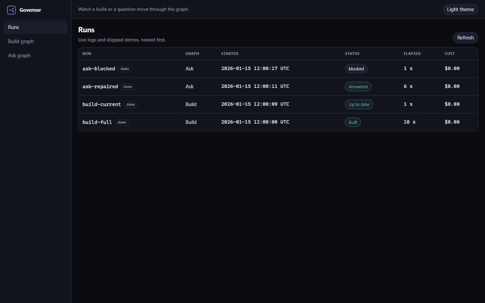
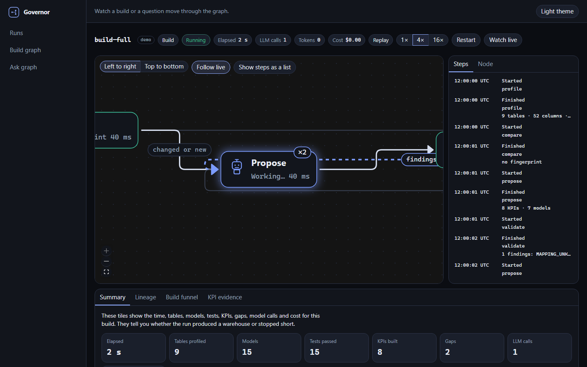
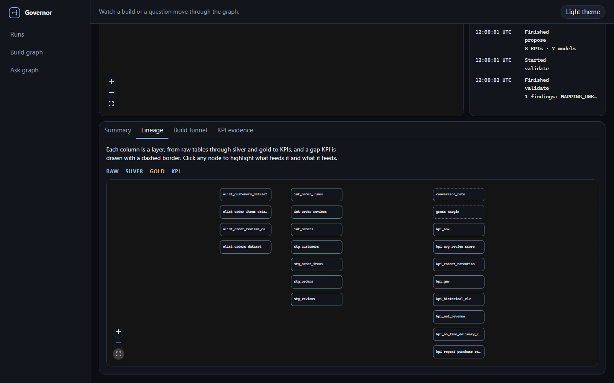
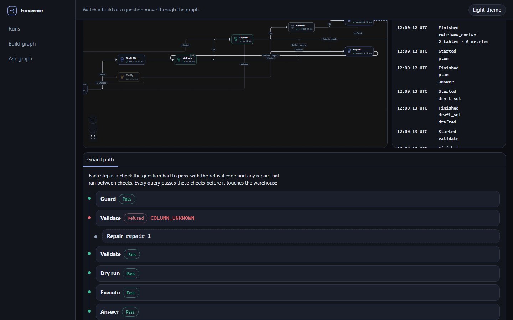

# Run console

The run console shows a build or a question moving through its graph. Each node lights up while it runs and keeps a one-line result, a duration and a retry count. Under the canvas, a build shows its summary, lineage, funnel and KPI evidence. An ask shows the guard path.

It reads the run log. It does not call a model.

## Run it in dev

From the repo root, start the API in open mode (no token; the ask routes stay protected):

```powershell
$env:GOVERNOR_CONSOLE_OPEN = "1"
uv run uvicorn governor.api.app:app
```

In `apps/console`:

```powershell
npm run dev
```

Vite serves the UI at `http://localhost:5173` and proxies `/v1/` to `http://localhost:8000`. Set `GOVERNOR_CONSOLE_ORIGINS` if the UI is on another origin. `VITE_API_BASE` overrides the API URL (default `/`).

`docker compose up` builds this UI into nginx on host port 8080 and proxies `/v1/` to the `api` service. Open mode stays off unless `GOVERNOR_CONSOLE_OPEN` is set in the environment.

## Replay and demo mode

A demo run is a shipped log. Opening one starts a replay: the original gaps, sped up, with no model call. The speeds are 1×, 4× and 16×. A run that is still going stays live; Replay switches a finished run back through the log.

The shipped demos are a full build (one design repair and one silver repair), an up-to-date build, an ask that was repaired, and an ask the guard blocked.

## Event contract

A run is one build or ask thread, stored as JSON lines with a version, a time, a run id, a graph name and a sequence number.
Each line is one of: run started, node started, node finished, node failed, run paused, run resumed, run finished.
Node lines carry the node id, the attempt count (the ×N badge), a duration and a summary of counts, names and codes.
Run totals are model calls, tokens and cost.
The fields and the reducer are specified in [batch 4, section 34](capstone/batch4.md).

## LangGraph Studio

Studio is a developer view of the build and ask graphs. It is not the product UI. The product UI is the run console, which reads the same graphs through `/v1/console`.

Studio needs a LangSmith account. From the repo root:

```
uvx --from "langgraph-cli[inmem]" langgraph dev
```

`langgraph.json` names the two graphs and has no `env` key. The server reads `OPENROUTER_API_KEY` from the shell. When that key is unset, the graphs compile with the offline fake model.

## Screenshots

Taken at 1440×900 by `npm run screenshots` in `apps/console` (`--url` of a running console, `--out` folder).








